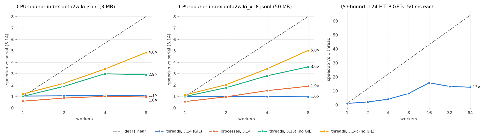

# findex — пошуковий рушій по Dota 2 wiki

[](https://github.com/dwysuxx/findex/actions/workflows/ci.yml)

Корпус: `data/dota2wiki.jsonl`, 124 статті про героїв. Індекс з positions:
`Index(terms=16_106, docs=124, positions=True)`, середня довжина документа 4220 токенів.

- [Lab 06 — The Async Crawler](#lab-06--the-async-crawler)
- [Lab 05 — Concurrency and the GIL](#lab-05--concurrency-and-the-gil)
- [Lab 04 — Typing, Testing, Packaging, CLI](#lab-04--typing-testing-packaging-cli)
- [Lab 03 — Ranking and the Object Model](#lab-03--ranking-and-the-object-model)
- [Lab 02 — The Inverted Index](#lab-02--the-inverted-index)

---

# Lab 06 — The Async Crawler

`findex crawl` — ввічливий асинхронний краулер на `asyncio` + `httpx`: таймаути, повтори з
backoff + jitter, `Retry-After`, `robots.txt`, ліміти на хост, черги по хостах, `TaskGroup`,
async-генератор сторінок, потоковий jsonl для `findex index`. Плюс локальне дзеркало корпусу,
на якому все це проміряно.

## L6.1 Етика: що краулимо і чому це дозволено

Краулер ганявся **лише по локальному дзеркалу** (`findex.crawler.mirror`) — сайт, який ми самі
піднімаємо на `127.0.0.1` зі статей нашого ж корпусу. Дозвіл очевидний, чужий сервер не
отримує жодного запиту, а бенчмарк відтворюваний. Посилання на справжній fandom.com на
сторінках дзеркала є, але вони поза allowlist і не запитуються (124 пропущені посилання в демо).

Краулер поводиться як чемний гість і на чужих сайтах:
- `User-Agent: findex-crawler/0.6 (+https://github.com/dwysuxx/findex; educational crawler, Lab 06)` — хто ми і де нас знайти;
- `robots.txt` на кожен origin, по одному запиту; `Crawl-delay` враховується; 5xx/мережева
  помилка на `robots.txt` → цей origin не краулимо (як Google), 4xx → обмежень немає;
- не більше `--per-host` (2) одночасних запитів і `--delay` між стартами на один origin;
- лише домени seed-ів (або `--allow-domain`), стоп на `--max-pages`.

## L6.2 Запуск

```bash
uv run python -m findex.crawler.mirror                     # друкує "ready http://127.0.0.1:PORT/" × 5
findex crawl http://127.0.0.1:PORT/ --max-pages 300 --concurrency 20 --timeout 2 -o data/crawl.jsonl
findex index data/crawl.jsonl -o crawl.bin --positions     # індексація — окремо, після краулу
findex search crawl.bin '"meat hook"' -k 3

findex crawl SEED --debug-loop        # asyncio debug: попередження про виклики > 100 мс — у crawl.log
uv run python -m findex.crawler.bench run --runs 3          # бенчмарк -> bench/crawl_results.jsonl
uv run python -m findex.crawler.experiments                 # «Prove it to yourself» -> bench/async_experiments.txt
```

## L6.3 M1 — один ввічливий запит

| Модуль | Що всередині |
|---|---|
| `crawler/fetch.py` | `fetch(client, url, *, timeout=10)` → `FetchResult(url, final_url, status, content_type, text, nbytes, elapsed, attempts, error)` |
| `crawler/robots.py` | `RobotsCache`: `robots.txt` на origin один раз (`asyncio.Lock` на origin), `allowed(url)`, `crawl_delay(url)` |
| `crawler/urls.py` | `canonicalize`, `host_allowed`, `parse_html` (stdlib `html.parser`: заголовок, видимий текст, посилання) |

- Кожна спроба — під `async with asyncio.timeout(timeout)`.
- **Повторюємо** 429, 5xx, таймаут, обрив з'єднання; не більше 3 спроб. Пауза:
  `min(cap, base·2^n) + U(0, base)` (base 0.5 с, cap 10 с). Jitter потрібен, щоб клієнти, які
  впали одночасно, не повернулися теж одночасно.
- **429 + `Retry-After`** (секунди або HTTP-дата) → чекаємо рівно стільки, скільки просить
  сервер. Якщо просить більше 60 с — здаємося, а не висимо.
- **Не повторюємо** 404 та інші 4xx: відповідь не зміниться. Redirect-цикл → `TooManyRedirects`
  (`max_redirects=5`), теж без повтору.
- `fetch` ніколи не кидає на мережевих чи HTTP-помилках — повертає `FetchResult` з `error`.
  `CancelledError` не перехоплює: зупинка краулу проходить крізь `fetch` вільно.
- Тести — `httpx.MockTransport`, без мережі, з підмінною `sleep`, тож backoff перевіряється миттєво:
  точні паузи, `Retry-After` (секунди й дата), відмова на 4xx, таймаут, обрив, redirect-цикл,
  User-Agent, Hypothesis-властивість меж backoff.

## L6.4 M2 — frontier і воркери

```
seeds ─► черги URL по хостах ─► ready: asyncio.Queue[_Host] ─► N воркерів у TaskGroup ─► out ─► async for page in crawl(...)
              ▲                  («токени» хостів, які                     │
              │                    можна запитувати ЗАРАЗ)                 │
              └───────────────────── нові посилання ◄──────────────────────┘
```

- `crawl(seeds, *, max_pages, concurrency, per_host, min_delay, allowed_domains, ...) -> AsyncGenerator[Page]`
  віддає `Page(url, title, text, fetched_at)`, щойно сторінку завантажено й розібрано.
- **Структурована конкурентність.** Генератор лише читає чергу `out`; уся робота — у
  runner-задачі з `asyncio.TaskGroup` на `concurrency` воркерів. Кінець — коли немає ні URL у
  чергах, ні в обробці (`all_done`): воркери, що чекають на порожній черзі, скасовуються.
  Споживач, що виходить раніше (`break`, Ctrl-C), закриває генератор (`aclosing`); `finally`
  скасовує runner, TaskGroup — воркерів, клієнт закривається (тест `test_crawl_early_stop_leaves_no_tasks`:
  після виходу в циклі не лишається жодної задачі). Баг у воркері не губиться — `ExceptionGroup`
  у споживача (тест).
- **Канонізація URL** + `seen`: схема й хост у нижньому регістрі, порт за замовчуванням прибрано,
  фрагмент відкинуто, кінцевий слеш прибрано, query відсортовано. Тест: кожен URL запитано рівно
  раз, хоча на нього ведуть `/a`, `/a#dup`, `/b/`, `/b?y=2&x=1`. Редирект на вже відому сторінку
  не дає дубля.
- **Ліміти:** глобальний `asyncio.Semaphore(concurrency)` на запити; per-host — `per_host`
  токенів (і `asyncio.Semaphore(per_host)` як жорстка межа); пауза `min_delay` (або `Crawl-delay`)
  між стартами на хост; allowlist доменів; бюджет `max_pages` — запитів, а не сторінок, і
  резервується без `await` між перевіркою та записом, тож перевищити його неможливо (тест: рівно
  17 запитів при `max_pages=17` і 8 воркерах).
- **Розбір HTML** — у `asyncio.to_thread` (CPU, див. L6.7).

**Чому черги по хостах, а не одна черга URL.** Перша версія мала одну FIFO-чергу URL і
`async with host_semaphore` у воркері. Бенчмарк показав head-of-line blocking: воркер брав URL
зайнятого хоста й чекав, тримаючи його, а URL вільних хостів стояли за ним. Тепер у кожного хоста
своя `deque` URL, а в спільній `asyncio.Queue` — «токени» хостів, яких можна запитувати просто
зараз (`per_host` штук на хост; з паузою — через `loop.call_at`). Воркер бере хост, а не URL, і
ніколи не чекає на зайнятий (Mercator-фронтир). Друга правка: токен пропускає URL, заборонені
`robots.txt` чи поза бюджетом, і витрачає свій слот паузи на перший URL, що справді потребує
запиту. Інакше кожне посилання на `/private/...` «з'їдало» 0.25 с без жодного запиту (регресійний
тест `test_crawl_robots_skips_do_not_eat_delay_slots`).

| 200 сторінок, 5 origin-ів | Одна FIFO-черга | Черги по хостах | Теоретичний мінімум |
|---|---|---|---|
| concurrency 5, per_host 2 | 15.08 с | 11.35 с | — |
| concurrency 20, per_host 2 | 13.11 с (макс. 9 у польоті) | **6.25 с** (10 у польоті) | ліміт 5 × 2 = 10 |
| concurrency 20, per_host 4 | 7.08 с (17 у польоті) | 5.24 с (20) | ліміт 20 |
| concurrency 20, per_host 2, delay 0.25 с | 30.17 с | **11.50 с** | ≈ 40 запитів/хост × 0.25 с = 10 с |

Сирі дані першої версії — `bench/crawl_results_fifo.jsonl`.

## L6.5 M3 — `findex crawl`

```
findex crawl SEED... [--max-pages 500] [--concurrency 10] [--per-host 2] [--delay 0] [--timeout 10]
                     [--allow-domain D]... [-o data/crawl.jsonl] [--log crawl.log] [--debug-loop]
```

- Кожна сторінка — рядок jsonl (`id`, `title`, `url`, `text`, `retrieved_at`), записаний **щойно
  вона прийшла** (`flush` — перерваний краул лишає на диску все, що встиг). `iter_documents` з
  Lab 01 читає цей файл без змін; тест проганяє `crawl → index → search` наскрізно.
- Живий `rich.Live` у stderr: сторінки / бюджет, стор./с, у польоті, у черзі, помилки й
  повтори, пропуски robots.txt / поза доменом.
- `crawl.log`: рядок на кожен URL (`200 31207B 0.104s attempts=1 URL` або
  `FAIL HTTP 404 after 1 attempt(s) ...`), кожен повтор з причиною і паузою, рішення robots.txt.
- Жодного дискового I/O в потоці циклу: логи йдуть через `QueueHandler` → `QueueListener` (на
  диск і в stderr пише окремий потік), рядки jsonl — через `asyncio.to_thread`, панель rich
  перемальовується задачею в циклі (`auto_refresh=False`), а не власним потоком rich.
- Вся індексація — **поза циклом подій**: `findex crawl` лише пише jsonl, `findex index` —
  окремий процес після нього. `findex.crawler` імпортується ліниво: `findex --help` не тягне httpx.

## L6.6 M4 — бенчмарк

**Стенд:** та сама машина (i7-9700KF, 8 ядер, Windows 10, Python 3.14.8). Дзеркало: 5 origin-ів
(різні порти = різні origin-и для robots.txt і лімітів), 248 сторінок героїв (124 статті × 2 копії)
+ 5 кореневих, затримка 50–150 мс на запит. Збої — лише на першу спробу, детерміновані: 6 сторінок
— 503, 6 — 429 з `Retry-After: 1`, 4 — відповідь через 3 с (довше за таймаут 2 с). Пастки на
сторінках: `/private/` (robots.txt), redirect-цикл, 404, PDF, посилання на fandom.com.

**Методика:** той самий seed, `max_pages = 200`, таймаут 2 с, 3 прогони на конфігурацію, медіана.
Кожен прогін — свіжий процес дзеркала (збої «першого запиту» знову ті самі) і свіжий процес
краулу (чесний пік RSS). Wall — від старту `crawl()` до останньої сторінки.

| Concurrency | Per-host | Delay, с | Pages | Wall, с (медіана ± розкид) | Pages/s | Errors | Retries | Макс. у польоті | Peak RSS, МБ | Speedup |
|---|---|---|---|---|---|---|---|---|---|---|
| 1 | 2 | 0 | 200 | 42.13 ± 3.20 | 4.7 | 0 | 11 | 1 | 45 | 1.0× |
| 5 | 2 | 0 | 200 | 11.35 ± 0.15 | 17.6 | 0 | 14 | 5 | 46 | 3.7× |
| 20 | 2 | 0 | 197 | 6.25 ± 0.09 | 31.5 | 1 | 14 | 10 | 46 | 6.7× |
| 20 | 4 | 0 | 199 | 5.24 ± 0.20 | 38.0 | 0 | 14 | 20 | 48 | 8.0× |
| 20 | 2 | 0.25 | 200 | 11.50 ± 0.07 | 17.4 | 0 | 12 | 8 | 47 | 3.7× |

Рядки 1–3 — таблиця завдання (concurrency 1/5/20 при `--per-host 2` за замовчуванням), рядки
4–5 — ціна ввічливості. Сирі дані — `bench/crawl_results.jsonl`.

- **1 → 5:** 3.7×, майже лінійно: 5 запитів перекривають очікування один одного.
- **5 → 20:** лише 1.8×, бо стеля ввічливості — 5 хостів × 2 = 10 запитів (виміряно: рівно
  10 у польоті). Плюс «хвіст»: повільні сторінки (таймаут 2 с + повтор) і `Retry-After: 1` дають
  ланцюжки по 3+ с, які паралельність не скорочує. Це закон Амдала, тільки в часі очікування.
- **`per_host 4`** знімає стелю до 20 (8.0×), і подальше прискорення впирається вже в хвіст.
- **Пам'ять** не залежить від concurrency (45–48 МБ): задача — це кадр корутини, а не потік.

## L6.7 Не блокувати цикл — що знайшов `debug=True`

`asyncio.run(..., debug=True)` (`--debug-loop`) логує кожен крок циклу, що тривав понад 100 мс.
Він знайшов чотири блокування — і жодне не було в «очевидному» місці:

| # | Де | Скільки | Чому | Виправлення |
|---|---|---|---|---|
| 1 | створення `httpx.AsyncClient` | 0.17 с | синхронно будує SSL-контекст (читає сертифікати certifi), навіть для http | `await asyncio.to_thread(make_client, ...)` |
| 2 | перший мережевий запит | 0.17–0.26 с, з холодним кешем `.pyc` | `httpcore` ліниво імпортує `anyio` і його asyncio-бекенд (≈ 30 модулів) прямо в циклі | `make_client` (уже в потоці) імпортує їх заздалегідь; так само `findex crawl` імпортує `findex.crawler.crawl` (httpx) **до** `asyncio.run` |
| 3 | кроки воркерів у CLI | 0.13–0.15 с, приблизно в половині прогонів тестів | потік авто-оновлення `rich.Live` конкурував з циклом за GIL (з `auto_refresh=False` — 4/4 зелені) | панель перемальовує задача в циклі (~1–5 мс на кадр) |
| 4 | `log.info(...)` і `f.flush()` у кроках | 0.35 с, рідко | запис на диск на Windows зрідка стоїть сотні мс (кеш, антивірус) — це блокуючий I/O | `QueueHandler` + `QueueListener`; рядки jsonl — `asyncio.to_thread` |

Як знаходив: `debug=True` пише, **яка задача** і **на якому рядку** тримала цикл. Для №2 — відтворення
з видаленим `__pycache__`; для №3 — той самий прогін з `auto_refresh=False`; для №4 — збіг за часом
двох «повільних» кроків різних задач з рядками журналу.

Після виправлень: бенчмарк з `debug=True` (окремі процеси) — **0** попереджень у 3 прогонах + 2 з холодним кешем,
CLI — **0** у 6 прогонах поспіль. Юніт-тест CLI запускає краул з `--debug-loop`, але «0 кроків
понад 100 мс» не перевіряє: на навантаженій машині (CI) це залежить від ОС, а не від коду. Тест
перевіряє детерміновану частину — жодного `coroutine ... was never awaited`.

**Де цикл заблокувався б, якби індексувати inline.** Розбір сторінки — 7.4 мс (медіана), до 16 мс;
токенізація — 2.9 мс. На 20 воркерів це десятки мілісекунд CPU на «раунд», протягом яких жоден
інший запит не обслуговується. Побудова індексу всіх 248 сторінок — 1.35 с: зроблена в корутині
наприкінці, вона заморозила б цикл на 1.35 с (і всі таймаути запитів, що летять). Тому розбір —
у `asyncio.to_thread`, а індексація — окремою командою після краулу. Якби CPU-роботи було більше
(скажімо, 100 мс на сторінку), потоки під GIL уже не рятували б — потрібен `ProcessPoolExecutor`
через `loop.run_in_executor`.

## L6.8 Збій, який оброблено, — з журналу

Демо: `findex crawl SEED --max-pages 300 --concurrency 20 --timeout 2 --debug-loop`, повний журнал —
`bench/crawl_demo.log` (253 сторінки за 8.5 с, 16 повторів, 24 помилки: 404 і redirect-цикли, 0 попереджень debug).

```
20:56:04,781 WARNING findex.crawler.fetch: retry 2/3 in 0.66s (HTTP 503, backoff): http://127.0.0.1:55648/wiki/drow_ranger
20:56:05,469 WARNING findex.crawler.fetch: retry 2/3 in 1.00s (HTTP 429, Retry-After 1s): http://127.0.0.1:55650/wiki/sven
20:56:07,294 WARNING findex.crawler.fetch: retry 2/3 in 0.81s (timeout after 2s, backoff): http://127.0.0.1:55648/wiki/shadow_shaman
20:56:10,533 WARNING findex.crawler.crawl: FAIL redirect loop (too many redirects) after 1 attempt(s), 0.720s: http://127.0.0.1:55650/loop/a
20:56:10,667 WARNING findex.crawler.crawl: FAIL HTTP 404 after 1 attempt(s), 0.132s: http://127.0.0.1:55650/missing/lifestealer
```

і що з ними сталося далі:

```
20:56:05,595 INFO    findex.crawler.crawl: 200 35809B 0.954s attempts=2 http://127.0.0.1:55648/wiki/drow_ranger
20:56:06,662 INFO    findex.crawler.crawl: 200 22141B 1.338s attempts=2 http://127.0.0.1:55650/wiki/sven
20:56:08,257 INFO    findex.crawler.crawl: 200 30636B 3.004s attempts=2 http://127.0.0.1:55648/wiki/shadow_shaman
```

- **503** → пауза з backoff і jitter (0.66 с), друга спроба — 200.
- **429** → пауза рівно `Retry-After` (1.00 с), друга спроба — 200.
- **Таймаут** (сервер відповідає через 3 с, таймаут 2 с) → `asyncio.timeout` скасовує очікування,
  backoff, друга спроба — 200 (дзеркало сповільнює лише перший запит).
- **Redirect-цикл** `/loop/a ↔ /loop/b` → `TooManyRedirects` після 5 переходів, без повторів.
- **404** → одразу «FAIL», без повторів.

## L6.9 Пояснення

**Чому 20 «воркерів» в одному потоці виграли там, де потоки з Lab 05 програли.** Lab 05
індексував — CPU-робота: байткод Python виконує один потік за раз, і потоки під GIL лише
передавали його один одному (0.97×). Краулер 95 % часу **чекає на мережу**. Чекання не потребує
ні GIL, ні ядра: `await` на сокеті повертає керування циклу, той через `select`/IOCP дізнається,
чия відповідь прийшла, і продовжує саме ту корутину. Тому одна нитка перекриває 20 очікувань
(6.7×), а CPU-частина (розбір, ≈ 10 мс на сторінку) — мала. Потоки на цьому навантаженні теж
масштабувалися б (Lab 05, I/O-бенчмарк: 15.7×), але кожен потік — це стек і об'єкт ОС:
1 000 потоків, що чекають 1 с, — +27.2 МБ RSS, 1 000 задач — +1.7 МБ (`experiments 6`). На
тисячах з'єднань різниця вирішальна.

**Що коштують ліміти на хост і чому вони лишились.** Без них concurrency 20 означало б 20
одночасних запитів на один сервер — це вже не краулер, а навантажувальний тест. Ціна видна в
таблиці: з `per_host 2` стеля 10 запитів (6.25 с), з `per_host 4` — 5.24 с, з паузою 0.25 с — 11.5 с.
Лишаємо: швидкість краулу обмежена тим, скільки дозволяє господар сайту, а не тим, скільки
можемо ми. На справжньому сайті 429 і бан коштували б більше, ніж ці секунди.

**«Prove it to yourself»** (`bench/async_experiments.txt`):

| Експеримент | Результат |
|---|---|
| `one()` проти `gen_one()` | `<coroutine object one>` і `<generator object gen_one>` — виклик нічого не виконує; `asyncio.run(one())` → 1 |
| 3 × `asyncio.sleep(1)`: послідовно / TaskGroup / TaskGroup з `time.sleep` | 3.02 с / **1.01 с** / 3.00 с |
| TaskGroup: задача падає через 0.1 с, сусід спить 10 с | сусіду — `CancelledError`, `except* ValueError` через **0.10 с**, тип — `ExceptionGroup` |
| 30 URL: новий `AsyncClient` на запит / один спільний | 0.39 с / **0.17 с** |
| `debug=True` + `time.sleep(0.5)` у корутині | `Executing <Task ...> took 0.501 seconds` |
| 1 000 потоків / 1 000 задач, кожна чекає 1 с | 1.15 с, **+27.2 МБ** / 1.03 с, **+1.7 МБ** |

## L6.10 Рефлексія (коротко)

1. Цикл: черга готових колбеків + селектор (на Windows — IOCP). Корутина на `await sock.recv()`
   реєструє інтерес до сокета, повертає керування циклу; цикл виконує інших; ОС повідомляє «дані
   є» → цикл ставить продовження корутини в чергу готових.
2. Кооперативна: перемикання лише на `await` — немає гонок між `await`-ами, рідко потрібні локи;
   небезпека — один блокувальний виклик зупиняє все. Витісняльна: ОС перемикає сама — одна повільна
   задача не морозить інших; небезпека — гонка будь-де. Лок в asyncio знову потрібен, коли між
   «перевірив» і «записав» є `await` (у нас — `RobotsCache`: інакше 20 воркерів зробили б 20
   запитів `robots.txt`).
3. `time.sleep(1)` блокує потік циклу: 19 інших воркерів стоять 1 с (експеримент 2: 3.00 с замість
   1.01). `asyncio.sleep` — це `await` на таймері: цикл реєструє «розбуди через 1 с» і працює далі.
4. `async def` — як генераторна функція: виклик створює об'єкт (корутину), але не виконує тіло.
   `await` — це `yield from` до циклу: корутина призупиняється, поки awaitable не готовий.
   `fetch(url)` без `await` — корутина, що ніколи не запуститься (і попередження «never awaited»).
5. `TaskGroup` — область: на виході всі задачі завершені; помилка однієї скасовує сусідів і
   піднімається як `ExceptionGroup` (кілька помилок разом), ловиться `except*`. `gather` без
   `return_exceptions` віддає першу помилку, а решта задач продовжують жити без нагляду.
6. Lab 05 — CPU-bound (потоки чекали на GIL); краулер — I/O-bound (чекання не тримає ні GIL, ні
   ядро). Одна нитка перекриває 20 очікувань, а CPU-частина мала. Див. L6.9.
7. Щоб `except Exception:` не перехоплював скасування: `CancelledError` — `BaseException`. Якби він
   був `Exception`, такий `except` навколо `await` «з'їв» би скасування: задача жила б далі,
   `TaskGroup` і таймаути зависли б, Ctrl-C не зупиняв би краул. `fetch` ловить лише конкретні
   `httpx`-винятки й `TimeoutError`.
8. Глобальний семафор обмежує наші ресурси (сокети, пам'ять, файлові дескриптори), per-host —
   навантаження на кожен сервер; потрібні обидва: 20 запитів можуть піти на один хост. `Retry-After`
   замінює власну формулу backoff: сервер сам каже, скільки чекати (а якщо занадто довго — здаємося).
9. Легка — в `asyncio.to_thread` (у нас розбір HTML); важка — у `ProcessPoolExecutor` через
   `loop.run_in_executor`; найкраще — після краулу окремою командою (у нас `findex index`).

## L6.11 Статус

- [x] `fetch`: `asyncio.timeout`, ≤ 3 спроби, backoff + jitter, `Retry-After`, без повторів на 4xx; тести на `MockTransport`
- [x] `RobotsCache`; чесний `User-Agent`; per-host ліміт + пауза; глобальний семафор; allowlist доменів
- [x] Frontier на `asyncio.Queue` (черги по хостах) + воркери в `TaskGroup`; канонізація + `seen`; async-генератор; чиста зупинка на `max_pages`
- [x] `findex crawl` → потоковий jsonl для `findex index`; `rich` live; `crawl.log`
- [x] `debug=True` чистий (знайдено й виправлено чотири блокування); індексація поза циклом
- [x] Бенчмарк concurrency 1/5/20 + ціна ввічливості; пояснення; оброблені збої з журналу
- [x] Етика: лише локальне дзеркало (L6.1)
- [x] Git-тег `lab-06`
- [ ] Stretch (відновлюваний краул на `aiosqlite`, ETag/`If-None-Match`, порт на `trio`/`anyio`) — не виконано

---

# Lab 05 — Concurrency and the GIL

Паралельна побудова індексу як map-reduce: `build_partial` → `merge`, три виконавці (`serial`,
`threads`, `processes`) з одним кодом, бенчмарк на звичайному CPython 3.14 та на free-threaded
3.13t / 3.14t, експерименти з GIL і гонкою даних, контрольний I/O-бенчмарк.

## L5.1 Запуск

```bash
findex index data/dota2wiki.jsonl -o index.bin --positions                       # --executor auto
findex index data/dota2wiki.jsonl -o index.bin --positions --executor processes -w 8
findex -v index ...                       # INFO: plan / map / merge у секундах

uv run pytest tests/test_parallel.py      # serial == threads == processes == Lab 04, побайтово

# бенчмарк (кожен прогін — окремий процес)
uv run python -m findex.bench_parallel scale data/dota2wiki.jsonl --times 16
uv run python -m findex.bench_parallel run data/dota2wiki_x16.jsonl --runs 3
uv run python -m findex.bench_parallel run data/dota2wiki_x16.jsonl --python "$(uv python find 3.14t)" \
    --configs serial:1 threads:1,2,4,8 processes:8
uv run python -m findex.bench_parallel table   # таблиця нижче
uv run python -m findex.bench_io               # I/O-бенчмарк
uv run python -m findex.bench_plot             # bench/speedup.png

# «Prove it to yourself» — на будь-якому інтерпретаторі
PYTHONPATH=src "$(uv python find 3.14t)" -m findex.gil_experiments   # повний вивід: bench/gil_experiments.txt
```

## L5.2 M1 — `build_partial` / `merge`

Модуль `findex/parallel.py`:

| Крок | Хто виконує | Що робить |
|---|---|---|
| `plan_chunks(corpus, n)` | батько | один прохід по **байтах** файлу (без JSON) → ≤ n шматків, збалансованих за розміром; кожному наперед призначено діапазон `doc_id` |
| `build_partial(chunk)` | воркер | сам відкриває файл, читає свій діапазон `[start, end)`, будує частковий індекс з глобальними `doc_id` |
| `merge(partials)` | батько | сортує шматки за `first_id` і конкатенує постінги кожного терма |

- **«Шлях» замість документів.** Корпус — один jsonl-файл, тому замість списку шляхів шматок — це
  `Chunk(path, start, end, first_line, first_id, slots)`: шлях і кілька чисел. Документи воркер
  читає сам — у процес не пересилається жодного тексту.
- **Глобальні `doc_id` наперед.** Кожен непорожній рядок резервує один `doc_id`. Тоді `merge` —
  просто конкатенація в порядку шматків: діапазони не перетинаються і вже впорядковані. Битий рядок
  лишає «дірку». `merge` бачить, що `first_id` наступного шматка не збігається з лічильником, і
  зсуває його `doc_id` (тест `test_bad_lines_renumbered_to_match_serial`).
- **Порядок термів у dict** — порядок першої появи, як і в послідовній побудові: перший шматок
  додає свої терми першим. Тому індекс **ідентичний аж до байтів pickle**, а не лише за `==`.
- **Спільний код.** Цикл накопичення постінгів винесено в `index.index_documents(docs, positions,
  first_id)`, а розбір рядка — у `corpus.parse_line`. Lab 04 і воркери виконують один і той самий код.

Тести (`tests/test_parallel.py`, 36 тестів): `merge([build_partial(весь корпус)])` дає той самий
pickle, що й `build_index` Lab 04; кожен виконавець × 1/2/4 воркери; pickle- і compact-транспорт;
брудний корпус (порожні рядки, битий JSON, запис без `text`); Hypothesis-властивість «будь-який
корпус × будь-яка кількість шматків == serial»; порядок `as_completed` не важливий; справжній
корпус (`slow`). Навіть `index.bin`, збудований ще в Lab 04, побайтово збігається з новим.

## L5.3 M2 — три виконавці, один прапорець

```
findex index CORPUS -o OUT [--executor auto|serial|threads|processes] [--workers N]
```

- `map_chunks` — той самий `build_partial` у звичайному циклі, `ThreadPoolExecutor` або
  `ProcessPoolExecutor`. Різниця лише в тому, який пул створює `_make_pool`.
- **Виняток воркера.** `fut.result()` у циклі `as_completed` піднімає його в батька. Для процесів
  traceback дочірнього процесу прикріплено як `__cause__` (`_RemoteTraceback`). Решту задач
  скасовано (`shutdown(cancel_futures=True)`), тож нічого не зависає. Тест:
  `test_worker_exception_surfaces` для всіх трьох виконавців.
- **spawn-safe.** На Windows інший метод старту й не доступний. `build_partial` визначено на рівні
  модуля. `__main__.py` тепер під `if __name__ == "__main__"`. Підпроцеси перевіряє тест
  `test_python_m_findex_is_spawn_safe`. У консольному скрипті `findex.exe` guard уже є.
- **`--executor auto`** (за замовчуванням) обирає за цифрами з L5.4:
  без GIL → `threads`; з GIL → `processes` від 4 МБ корпусу, інакше `serial`.
  Наш 3.1 МБ корпус на звичайному 3.14 будується послідовно, бо там процеси дають нічию (1.00×),
  а на 6.3 МБ (×2) уже виграють 1.3×.

## L5.4 M3 — бенчмарк

**Машина:** Intel Core i7-9700KF @ 3.60 GHz, 8 ядер / 8 потоків (без Hyper-Threading), 16 ГБ RAM,
Windows 10 Pro (метод старту — `spawn`). Python 3.14.8 (GIL), 3.13.16t і 3.14.8t
(free-threaded, `sys._is_gil_enabled() == False`), встановлені через `uv python install 3.13t 3.14t`.

**Методика.** Індекс з `--positions`. Кожна конфігурація — 3 прогони, кожен в **окремому
процесі** (пік RSS монотонний, тож у спільному процесі прогони успадковували б пік попереднього).
Перед серією — один прогрівальний прогін: файл у кеші ОС, `.pyc` скомпільовані. Wall —
`perf_counter` навколо `build_parallel`, без старту інтерпретатора, але **разом зі** стартом пулу.
CPU — `process_time` батька плюс `process_time` кожного процесу-воркера на кінець його останньої
задачі (включно зі стартом інтерпретатора та імпортами). Пік RSS — `PeakWorkingSetSize` (WinAPI).
Merge — лише `merge()`. Speedup — відносно `serial ×1` на 3.14 того ж корпусу.

Корпусів два: справжній (3.1 МБ, 124 статті; serial — пів секунди) і **×16** (50 МБ, 1984
статті: ті самі статті з унікальними id, `bench_parallel scale`). На 0.5 с роботи сам запуск
восьми spawn-воркерів важить стільки ж, скільки побудова, тож для чесного виміру паралельної
частини потрібен більший корпус. Обмеження ×16: словник не росте (16 106 термів), ростуть лише
постінги.

`processes (pickle)` — перша версія, де воркер повертає `PartialIndex` як є (pickle об'єктів).
`processes` — поточна, з компактним транспортом (L5.5). `serial ×8` — той самий цикл, але
8 шматків: показує ціну `merge` восьми часткових індексів.



**dota2wiki.jsonl** (3.13 МБ). Speedup — відносно serial ×1 на Python 3.14.

| Python | Executor | Workers | Wall, с (медіана ± розкид) | CPU, с | Peak RSS батька, МБ | RSS воркерів, МБ | Merge, с | Speedup |
|---|---|---|---|---|---|---|---|---|
| 3.14 | serial | 1 | 0.54 ± 0.08 | 0.55 | 71 | — | 0.002 | 1.00× |
| 3.14 | serial | 8 | 0.51 ± 0.04 | 0.52 | 71 | — | 0.011 | 1.07× |
| 3.14 | threads | 1 | 0.53 ± 0.13 | 0.47 | 71 | — | 0.002 | 1.03× |
| 3.14 | threads | 2 | 0.52 ± 0.02 | 0.50 | 72 | — | 0.006 | 1.05× |
| 3.14 | threads | 4 | 0.50 ± 0.05 | 0.50 | 70 | — | 0.008 | 1.10× |
| 3.14 | threads | 8 | 0.51 ± 0.04 | 0.52 | 72 | — | 0.011 | 1.07× |
| 3.14 | processes (pickle) | 1 | 1.15 ± 0.19 | 1.22 | 72 | 49 | 0.008 | 0.47× |
| 3.14 | processes (pickle) | 2 | 0.75 ± 0.02 | 1.34 | 71 | 74 | 0.011 | 0.73× |
| 3.14 | processes (pickle) | 4 | 0.63 ± 0.00 | 1.67 | 73 | 131 | 0.015 | 0.87× |
| 3.14 | processes (pickle) | 8 | 0.63 ± 0.07 | 2.38 | 75 | 232 | 0.018 | 0.86× |
| 3.14 | processes | 1 | 0.93 ± 0.04 | 1.00 | 74 | 52 | 0.007 | 0.58× |
| 3.14 | processes | 2 | 0.64 ± 0.00 | 1.14 | 75 | 79 | 0.009 | 0.86× |
| 3.14 | processes | 4 | 0.54 ± 0.01 | 1.61 | 77 | 137 | 0.011 | 1.00× |
| 3.14 | processes | 8 | 0.57 ± 0.15 | 2.27 | 80 | 242 | 0.015 | 0.95× |
| 3.13t (GIL off) | serial | 1 | 0.50 ± 0.07 | 0.48 | 80 | — | 0.003 | 1.08× |
| 3.13t (GIL off) | threads | 1 | 0.54 ± 0.13 | 0.52 | 83 | — | 0.005 | 1.01× |
| 3.13t (GIL off) | threads | 2 | 0.29 ± 0.00 | 0.56 | 90 | — | 0.009 | 1.88× |
| 3.13t (GIL off) | threads | 4 | 0.18 ± 0.00 | 0.64 | 101 | — | 0.014 | 2.99× |
| 3.13t (GIL off) | threads | 8 | 0.19 ± 0.03 | 0.86 | 118 | — | 0.019 | 2.90× |
| 3.14t (GIL off) | serial | 1 | 0.44 ± 0.00 | 0.44 | 83 | — | 0.003 | 1.24× |
| 3.14t (GIL off) | threads | 1 | 0.45 ± 0.08 | 0.44 | 87 | — | 0.004 | 1.22× |
| 3.14t (GIL off) | threads | 2 | 0.25 ± 0.00 | 0.48 | 94 | — | 0.008 | 2.15× |
| 3.14t (GIL off) | threads | 4 | 0.16 ± 0.00 | 0.58 | 104 | — | 0.012 | 3.40× |
| 3.14t (GIL off) | threads | 8 | 0.11 ± 0.01 | 0.73 | 124 | — | 0.016 | 4.85× |
| 3.14t (GIL off) | processes | 8 | 0.55 ± 0.00 | 2.47 | 95 | 286 | 0.017 | 0.99× |

**dota2wiki_x16.jsonl** (50.1 МБ). Speedup — відносно serial ×1 на Python 3.14.

| Python | Executor | Workers | Wall, с (медіана ± розкид) | CPU, с | Peak RSS батька, МБ | RSS воркерів, МБ | Merge, с | Speedup |
|---|---|---|---|---|---|---|---|---|
| 3.14 | serial | 1 | 7.85 ± 0.68 | 7.86 | 713 | — | 0.003 | 1.00× |
| 3.14 | serial | 8 | 8.08 ± 0.12 | 8.02 | 650 | — | 0.083 | 0.97× |
| 3.14 | threads | 1 | 7.90 ± 0.50 | 7.86 | 713 | — | 0.003 | 0.99× |
| 3.14 | threads | 2 | 7.92 ± 0.24 | 7.86 | 716 | — | 0.033 | 0.99× |
| 3.14 | threads | 4 | 7.99 ± 0.15 | 7.95 | 685 | — | 0.056 | 0.98× |
| 3.14 | threads | 8 | 8.14 ± 0.11 | 8.11 | 668 | — | 0.084 | 0.97× |
| 3.14 | processes (pickle) | 1 | 19.20 ± 0.28 | 19.58 | 775 | 327 | 0.048 | 0.41× |
| 3.14 | processes (pickle) | 2 | 10.47 ± 0.16 | 19.83 | 742 | 366 | 0.071 | 0.75× |
| 3.14 | processes (pickle) | 4 | 6.40 ± 0.05 | 20.55 | 746 | 428 | 0.104 | 1.23× |
| 3.14 | processes (pickle) | 8 | 5.73 ± 0.14 | 21.02 | 757 | 537 | 0.134 | 1.37× |
| 3.14 | processes | 1 | 14.27 ± 0.27 | 14.98 | 707 | 317 | 0.034 | 0.55× |
| 3.14 | processes | 2 | 8.16 ± 0.18 | 16.00 | 707 | 354 | 0.056 | 0.96× |
| 3.14 | processes | 4 | 5.21 ± 0.22 | 17.55 | 725 | 439 | 0.086 | 1.51× |
| 3.14 | processes | 8 | 4.15 ± 0.09 | 20.95 | 744 | 562 | 0.111 | 1.89× |
| 3.13t (GIL off) | serial | 1 | 7.84 ± 0.04 | 7.83 | 815 | — | 0.004 | 1.00× |
| 3.13t (GIL off) | threads | 1 | 7.87 ± 0.09 | 7.88 | 818 | — | 0.005 | 1.00× |
| 3.13t (GIL off) | threads | 2 | 4.46 ± 0.20 | 8.75 | 826 | — | 0.044 | 1.76× |
| 3.13t (GIL off) | threads | 4 | 2.80 ± 0.05 | 10.23 | 845 | — | 0.075 | 2.81× |
| 3.13t (GIL off) | threads | 8 | 2.19 ± 0.09 | 13.72 | 877 | — | 0.113 | 3.59× |
| 3.14t (GIL off) | serial | 1 | 6.93 ± 0.34 | 6.94 | 841 | — | 0.003 | 1.13× |
| 3.14t (GIL off) | threads | 1 | 6.93 ± 0.23 | 6.94 | 847 | — | 0.004 | 1.13× |
| 3.14t (GIL off) | threads | 2 | 3.87 ± 0.03 | 7.59 | 853 | — | 0.040 | 2.03× |
| 3.14t (GIL off) | threads | 4 | 2.29 ± 0.02 | 8.69 | 873 | — | 0.071 | 3.42× |
| 3.14t (GIL off) | threads | 8 | 1.56 ± 0.06 | 10.56 | 903 | — | 0.113 | 5.03× |
| 3.14t (GIL off) | processes | 8 | 3.75 ± 0.25 | 18.39 | 898 | 678 | 0.109 | 2.09× |

Сирі дані: `bench/results.jsonl` (150 прогонів), таблиця — `bench/table.md`.

## L5.5 Податок на pickle, GC і закон Амдала — як процеси стали з 0.79× на 1.89×

Перший бенчмарк процесів на ×16 дав **0.79×** при 8 воркерах, а з одним воркером — 24 с
замість 8.5. Розклад на справжньому корпусі пояснив чому:

| Операція над частковим індексом (124 док., 141 059 постінгів) | Час |
|---|---|
| побудова `build_partial` | 0.54 с |
| `pickle.dumps` (у воркері) | 0.33 с |
| `pickle.loads` (**у батька, послідовно**) | 0.39 с |
| компактно: пласкі списки int → `marshal.dumps` / `marshal.loads` | 0.07 + 0.08 / 0.04 с |
| відновити об'єкти `Posting` у батька | 0.18 с |

**Пересилати результат було дорожче, ніж його обчислити**, і найдорожча частина (`loads`)
виконувалась у батька — одним ядром. Три зміни:

1. **Компактний транспорт** (`build_partial_compact` / `_decode`). Воркер кодує постінги в
   `(term, doc_ids, tfs, усі positions підряд)` і повертає `marshal`-байти. `marshal` працює
   лише з `int`/`str`/`list`/`tuple`: не викликає `__reduce__` для кожного об'єкта й не тягне
   імені класу.
2. **Пауза GC** (`utils.gc_paused`). Батько створює мільйони об'єктів, і циклічний GC, рахуючи
   алокації, раз у раз обходить купу, що росте. Циклів побудова не створює, тож GC тут лише
   заважає: декодування ×16 прискорилось з 3.6 до 1.85 с, а послідовна побудова — з 8.8 до 7.0 с
   (це прискорило й базову лінію, тому speedup у таблиці чесний).
3. **Конвеєр:** для процесів шматків у 4 рази більше, ніж воркерів (`CHUNKS_PER_PROCESS`).
   Батько декодує готові шматки, поки воркери рахують решту. На ×16 при 8 воркерах:
   1 шматок на воркер — 5.3 с, 4 — 4.6 с, 16 — 5.1 с (накладні витрати на шматок).

**Закон Амдала тут — не `merge`.** Сам `merge` займає 0.11 с, тобто 1.4 % послідовного часу:
стеля в 70× нічого не пояснює. Справжня послідовна частина — усе, що робить батько:
план, декодування, побудова об'єктів `Posting`, merge. За `parent_cpu` з `bench/results.jsonl`
(×16, 8 воркерів, serial = 7.85 с):

| Транспорт | CPU батька | Частка s = CPU батька / serial | Стеля 1/s | Амдал при N = 8: 1/(s + (1−s)/8) | Виміряно |
|---|---|---|---|---|---|
| pickle | 4.88 с | 0.62 | 1.6× | 1.50× | 1.37× |
| compact | 3.25 с | 0.41 | 2.4× | 2.07× | 1.89× |

Прогноз Амдала з точністю до 10 % збігається з виміром. Решта — накладні витрати (старт пулу,
IPC). Щоб піти далі, треба не створювати мільйони Python-об'єктів у батька взагалі: наприклад,
тримати постінги в масивах (Lab 08) або ділити корпус між воркерами за термами, а не за документами.

## L5.6 M4 — free-threaded Python

- **Масштабування.** Той самий `ThreadPoolExecutor`, що на 3.14 стоїть на 1.0×, на 3.14t при
  8 потоках дає **5.0×** (×16) і 4.85× (справжній корпус) — найкращий результат серед усіх
  конфігурацій. На 3.13t — 3.6×: у 3.14 free-threaded збірка отримала спеціалізований інтерпретатор
  і менше конкуренції за лічильники посилань.
- **Ціна.** CPU 3.14t при 8 потоках — 10.6 с проти 6.9 с у одного потоку: +50 % на конкуренцію
  (атомарні refcount-и на спільних об'єктах, блокування dict, пропускна здатність пам'яті). Плюс
  RSS трохи більший (≈ 900 проти 713 МБ). Однопотоковий 3.14t (із `gc_paused`) не повільніший за
  GIL-збірку; у першому прогоні без паузи GC 3.13t був на 25 % повільніший.
- **Процеси на 3.14t** (2.1×) програють потокам удвічі. Без GIL потоки мають усі переваги процесів
  і жодної їхньої ціни: спільна пам'ять, нічого не треба пересилати. Звідси `auto` → `threads`.

**«Prove it to yourself»** (`gil_experiments`, повний вивід — `bench/gil_experiments.txt`),
`sum(i*i for i in range(10**7))`:

| | 3.14 (GIL) | 3.13t | 3.14t |
|---|---|---|---|
| один раз | 0.80 с | 0.76 с | 0.89 с |
| двічі послідовно | 1.58 с | 1.56 с | 1.76 с |
| двічі у 2 потоках | **1.57 с** — як послідовно | **0.77 с** | **0.87 с** |
| двічі у 2 процесах (пул уже запущено) | 0.98 с | 0.89 с | 1.07 с |
| 2 потоки, `setswitchinterval(0.0001)` | 2.00 с (було 1.65) — у 50 разів частіші передачі GIL | 0.77 с — GIL немає, нічого передавати | 0.88 с |

**Гонка, яку ховає GIL.** У `findex` її немає за побудовою: `build_partial` працює лише з
локальними змінними, а все спільне з'являється тільки в `merge`, в одному потоці. Щоб
побачити, що сталося б інакше, `gil_experiments race` рахує частоти термів усього корпусу
(523 271 токен) у **спільному** `Counter` з 8 потоків (`cf[tok] += 1`):

| | 3.14 (GIL) | 3.13t | 3.14t |
|---|---|---|---|
| спільний `Counter`, без Lock — втрачено оновлень (3 прогони) | 0, 0, 0 | 9 209, 10 356, 10 283 | 10 053, 10 706, 10 376 |
| виправлення: локальний `Counter` у потоці + `update` під `Lock` | 0, 0, 0 | 0, 0, 0 | 0, 0, 0 |
| `shared += 1`, 2 потоки × 10⁶ — втрачено (5 прогонів) | 0 ×5 | 952–983 тис. | 976–996 тис. |

Код без Lock **некоректний і на GIL-збірці**: `cf[tok] += 1` — це окремі
`BINARY_SUBSCR` → `BINARY_OP +=` → `STORE_SUBSCR`. GIL може перемкнутися між ними, просто з 5-мс
інтервалом і перевіркою «віддати GIL» лише в певних точках циклу це майже не стається: у наших
прогонах — нуль. Без GIL потоки справді виконуються одночасно, і втрачається ≈ 2 % оновлень
`Counter` і майже половина інкрементів `shared`. Виправлення — не ставити `Lock` навколо кожного
`+= 1` (це знову серіалізація), а **прибрати спільний стан**: кожен потік рахує свій `Counter`, а
спільний змінюється один раз на потік, під `Lock`. Це той самий map-reduce, що в `parallel.py`.

## L5.7 Бонус: I/O-bound — тут потоки масштабуються

`findex.bench_io`: локальний `ThreadingHTTPServer` в окремому процесі віддає 124 документи
з затримкою 50 мс на запит (модель мережі: відтворювано і без навантаження на чужий сервер).
Клієнт качає їх через `ThreadPoolExecutor` на звичайному 3.14 **з GIL**, 5 прогонів:

124 GET-запитів, затримка 50 мс; теоретичний мінімум серійно: 6.2 с

| Потоків | Wall, с (медіана) | Speedup |
|---|---|---|
| 1 | 8.20 | 1.0× |
| 2 | 4.07 | 2.0× |
| 4 | 2.05 | 4.0× |
| 8 | 1.01 | 8.1× |
| 16 | 0.52 | 15.7× |
| 32 | 0.62 | 13.1× |
| 64 | 0.65 | 12.6× |

Поки потік чекає на `recv()`, GIL відпущено, тож до 16 потоків прискорення майже ідеальне. Далі
вузьким місцем стає сам локальний сервер (потік і TCP-з'єднання на кожен запит), а не клієнт.
Один потік витрачає 66 мс на запит замість 50: таймер Windows має роздільність ≈ 15.6 мс.
Той самий `ThreadPoolExecutor` і та сама GIL-збірка: на CPU-задачі — 1.0×, на I/O — 15.7×.

## L5.8 Пояснення: чому так

**GIL і CPU-bound.** CPython керує пам'яттю підрахунком посилань: кожен `INCREF`/`DECREF` — це
неатомарне «прочитати → змінити → записати» в заголовку об'єкта. GIL — один м'ютекс на
інтерпретатор: байткод виконує лише потік, який його тримає. Індексація — чистий Python:
`json.loads`, регулярний вираз, `Counter`, створення `Posting`. Майже весь час GIL зайнятий.
Вісім потоків по черзі передають його один одному кожні 5 мс. У таблиці це видно напряму: у
`threads` на 3.14 CPU ≈ wall (8.1 с і 8.1 с при 8 потоках) — у кожен момент працює одне ядро,
решта чекає на GIL. Плюс накладні витрати на перемикання та скинуті кеші, тому 8 потоків трохи
*повільніші* за один (0.97×).

**Процеси.** Кожен воркер — окремий інтерпретатор зі своїм GIL, тож 8 ядер справді працюють.
Але за це платять тричі, і таблиця показує всі три рахунки:
1. **CPU проти wall:** ×16, 8 процесів — wall 4.15 с, але CPU 21 с проти 7.9 с послідовно. Зайві
   13 с — це ≈ 4 с на запуск 8 інтерпретаторів з імпортами, ≈ 6 с на кодування результатів і
   повільнішу роботу ядер під повним навантаженням (`task_cpu` 13.6 проти 7.9 с) і 3.25 с
   декодування в батька.
2. **Пам'ять:** батько 744 МБ + воркери 562 МБ ≈ 1.3 ГБ проти 713 МБ послідовно. Кожен процес
   тримає свій інтерпретатор і свою копію часткового індексу.
3. **Пересилання (pickle):** з pickle-транспортом CPU — 21 с, з яких лише 8.6 с — корисна робота
   воркерів. Батько витрачає 4.9 с на `loads`, і це послідовна частина.

**Амдал.** Мінімальна послідовна частина — не `merge` (1.4 %), а матеріалізація фінального
графа об'єктів у батька: 41 % з компактним транспортом. Стеля 2.4×, при 8 воркерах прогноз —
2.07×, виміряно 1.89×. Тому зростання кривої `processes` на графіку сповільнюється.

**Free-threading.** Без GIL потоки виконують байткод паралельно: 5.0× на 8 ядрах. Немає ні
пересилання, ні другої копії індексу, ні старту інтерпретаторів. Ціна — ≈ 50 % додаткового CPU
на конкуренцію і **коректність, яка тепер залежить від вас**: GIL випадково серіалізував
read-modify-write, і баг зі спільним `Counter` на звичайній збірці не проявився жодного разу,
а без GIL втрачалося ≈ 2 % оновлень за кожен прогін.

**Підсумок.** I/O-bound → потоки (GIL відпускається на очікуванні). CPU-bound на звичайному
CPython → процеси, якщо робота важча за запуск пулу й пересилання, а результат компактний.
CPU-bound на free-threaded → потоки, без спільного стану між ними.

## L5.9 Рефлексія (коротко)

1. GIL — м'ютекс інтерпретатора: байткод виконує лише потік, який його тримає. Він захищає
   внутрішній стан CPython (refcount-и, алокатор, внутрішність dict/list). Ваші інваріанти він
   не захищає: `x += 1`, «перевірив — потім записав», узгодженість двох полів.
2. Вісім потоків по черзі брали GIL: один токенізував, сім чекали. Кожні 5 мс — запит на
   перемикання, передача GIL, холодний кеш. CPU ≈ wall (8.1 с), тобто працює одне ядро.
3. Запуск 8 інтерпретаторів з імпортами (≈ 4 с), кодування результатів у воркерах, повільніша
   робота ядер під повним навантаженням і декодування в батька (3.25 с). Див. L5.8, п. 1.
4. Воркер отримує функцію як посилання «модуль + ім'я» і імпортує її. У лямбди імені немає:
   `PicklingError: Can't pickle local object <lambda>` (на 3.13t: `AttributeError: Can't get
   local object`).
5. `fork` клонує батьківський процес (швидко, пам'ять копіюється при записі). Небезпечно, якщо
   в батька були інші потоки: дитина успадковує захоплені ними локи, але не потоки, що мали б їх
   відпустити, — дедлок. `spawn` запускає чистий інтерпретатор і **імпортує головний модуль**.
   Без `if __name__ == "__main__"` цей імпорт знову запустив би пул — і так рекурсивно.
6. Speedup ≤ 1/(s + (1−s)/N). При s = 0.15 і N → ∞: 1/0.15 ≈ 6.7×. У нас s = 0.41 → 2.4×.
7. Бо GIL випадково серіалізував read-modify-write. Ні: на звичайній збірці код теж
   некоректний, гонка там просто рідкісна (у наших прогонах — нуль, але ніхто не гарантує).
8. `LOAD_GLOBAL shared` → `LOAD_SMALL_INT 1` → `BINARY_OP +=` → `STORE_GLOBAL shared`
   (`gil_experiments dis`). Потік A прочитав 5, потік B прочитав 5 і записав 6, A записує 6:
   одне оновлення втрачено.
9. Потоки — I/O (124 запити: 15.7×). Процеси — CPU-bound чистий Python на GIL-збірці (×16:
   1.89×). Ні те, ні те — десятки тисяч одночасних з'єднань: потік на з'єднання — забагато
   пам'яті й перемикань, процес — тим паче. Потрібен `asyncio` (Lab 06).

## L5.10 Статус

- [x] `build_partial` / `merge`; serial, threads і processes дають побайтово ідентичний індекс (тести, Hypothesis)
- [x] `--executor {auto,serial,threads,processes}`, `--workers N`; spawn-safe; виняток воркера — з traceback, без зависання
- [x] Бенчмарк: wall, CPU, RSS батька і воркерів, merge, speedup; 1/2/4/8 воркерів (8 = `os.cpu_count()`) × 3 виконавці × 3 прогони × 2 корпуси; машина й методика описані
- [x] Графік speedup vs workers з ідеальною лінією
- [x] Free-threaded 3.13t і 3.14t; гонка зі спільним `Counter` показана й виправлена
- [x] Пояснення: GIL, I/O vs CPU, податок на pickle, Амдал, free-threading
- [x] I/O-бенчмарк: потоки масштабуються
- [x] Git-тег `lab-05`
- [ ] Stretch (`shared_memory` / `mmap`, `InterpreterPoolExecutor`) — не виконано

---

# Lab 04 — Typing, Testing, Packaging, CLI

`findex` — встановлюваний пакет з командою `findex`: pyright strict без помилок, 118 тестів
(з них 6 Hypothesis-властивостей), CLI на typer + rich, логування в stderr, CI на GitHub Actions.

## L4.1 Встановлення

```bash
# з релізу на GitHub (wheel, прикріплений до v0.4.0)
uv tool install https://github.com/dwysuxx/findex/releases/download/v0.4.0/findex-0.4.0-py3-none-any.whl

# або з локального wheel / сирців
uv build                                   # -> dist/findex-0.4.0-py3-none-any.whl і .tar.gz
uv tool install dist/findex-0.4.0-py3-none-any.whl
uv tool install .                          # прямо з репозиторію

findex --version                           # findex 0.4.0

# розробка: середовище з lockfile (uv.lock закомічено)
uv sync
```

## L4.2 CLI

```bash
findex index data/dota2wiki.jsonl --out index.bin --positions     # rich progress bar у stderr
findex index data/dota2wiki.jsonl -o small.json --limit 20        # формат за розширенням
findex search index.bin '"meat hook" OR rot' --k 5                # таблиця з підсвіченими сніпетами
findex search index.bin pudge --scorer tfidf --explain            # + дерево запиту і розклад score
findex search index.bin pudge --json | jq -r .title               # JSON lines у stdout
findex stats index.bin --top 10                                   # числа Lab 01, гарно
findex stats index.bin --json
findex -v  search ...     # INFO   (розмір кешу)
findex -vv search ...     # DEBUG  (@timed, cache HIT/MISS)
python -m findex ...      # те саме без встановлення
```

```
$ findex search index.bin '"meat hook" OR rot' -k 2
                       "meat hook" OR rot — bm25, top-2
┌───┬────────┬───────────────┬────────────────────────────────────────────────┐
│ # │  score │ документ      │ сніпет                                         │
├───┼────────┼───────────────┼────────────────────────────────────────────────┤
│ 1 │ 26.013 │ pudge         │ …throw of Pudge's signature Meat Hook strikes  │
│   │        │               │ fear into his foes. Disoriented, his foe       │
│   │        │               │ stumbles, gagging on a sudden stench of Rot .  │
│   │        │               │ As it looks up at the…                         │
├───┼────────┼───────────────┼────────────────────────────────────────────────┤
│ 2 │  3.787 │ dragon_knight │ …and frail, its wings tattered, its few        │
│   │        │               │ remaining scales stricken with scale-rot, its  │
│   │        │               │ fangs ground to nubs, and its fire-gouts no    │
│   │        │               │ more threatening than a…                       │
└───┴────────┴───────────────┴────────────────────────────────────────────────┘

$ findex search index.bin pudge -k 2 --json --no-snippets
{"rank": 1, "doc_id": 13, "title": "pudge", "score": 8.141226}
{"rank": 2, "doc_id": 91, "title": "slark", "score": 3.465375}
```

(У терміналі збіги в сніпетах підсвічені жовтим.)

**Правила виводу.** У stdout ідуть лише дані (таблиця або JSON). Прогрес-бар, логи й помилки
пишуться в stderr. Очікувані помилки дають один рядок і код виходу 1, без traceback:

```
$ findex search nope.bin x            ; echo $?
Помилка: файл індексу не знайдено: nope.bin
1
$ findex search index.bin '(pudge'    ; echo $?
Помилка: помилка в запиті '(pudge': немає закриваючої дужки
1
$ findex search README.md pudge
Помилка: не вдалося прочитати індекс README.md (UnpicklingError): invalid load key, '#'.
$ findex search small.bin '"meat hook"'      # індекс без --positions
Помилка: Фразові запити потребують індексу з positions: findex index <корпус> --positions --out index.bin
```

Неправильне значення опції (`--scorer nope`) — помилка використання typer/click, код 2.

```
$ findex -vv search index.bin pudge --repeat 2 -k 1 --no-snippets >/dev/null
DEBUG    findex.utils: load took 284.84 ms
DEBUG    findex.utils: Searcher._rank_ids took 0.07 ms
DEBUG    findex.engine: query='pudge' k=1 cache=MISS
DEBUG    findex.utils: Searcher.search took 1.33 ms
DEBUG    findex.engine: query='pudge' k=1 cache=HIT
DEBUG    findex.utils: Searcher.search took 0.60 ms
INFO     findex.cli: cache: CacheInfo(hits=1, misses=1, maxsize=256, currsize=1)
```

## L4.3 M1 — типізація (pyright strict)

`[tool.pyright] typeCheckingMode = "strict"`, `include = ["src"]`: **0 errors**. Що зроблено:

- `Scorer` — `typing.Protocol`. `BM25`, `TfIdf` і звичайна функція з тією самою сигнатурою
  задовольняють його без успадкування.
- Генератори повертають `Iterator[...]` (`tokenize`, `iter_documents`), а приймають `Iterable[...]`
  (`build_from_documents`, `count_tokens`). `@contextmanager`-функції повертають `Generator[Index]`.
- `Literal`: `Format = Literal["pickle", "json"]`, `Engine = Literal["merge", "set"]`,
  `ScorerName = Literal["bm25", "tfidf"]`. typer за тими самими анотаціями будує вибір значень
  і перевіряє його.
- PEP 695: `def timed[**P, R](fn: Callable[P, R]) -> Callable[P, R]` зберігає сигнатуру
  декорованої функції. `build_objects[P: (PlainPosting, SlotPosting)]`, псевдоніми `type Postings = ...`.
- `TypedDict` описує форму JSON-файлу індексу (`IndexJSON`, `DocMetaJSON`). `@overload` на
  `ResultList.__getitem__`: `int -> SearchResult`, `slice -> ResultList`.
- Звуження (narrowing): `load_pickle` перевіряє `isinstance(obj, Index)` (pickle повертає `Any`),
  `TextStore` присвоює `self._offsets = self._build()` замість `# type: ignore`.

Усі винятки з перевірки, кожен з причиною в коді:

| Де | Що | Чому |
|---|---|---|
| `engine.py` | `pyright: ignore[reportPrivateUsage]` на `functools._CacheInfo` | у типу `cache_info()` немає публічного імені |
| `index.py`, `ranking.py` | `type: ignore[assignment]` на `__hash__ = None` | змінний контейнер з `__eq__` не хешується (як `list`); typeshed чекає метод |
| `explain.py` | `*args: Any` у базовій `@singledispatch`-функції | кожна зареєстрована реалізація має свою сигнатуру |
| `cli.py` | `Literal` через звичайне присвоєння, а не `type X = ...` | typer читає анотації під час виконання і не розгортає `TypeAliasType` |

## L4.4 M2 — тести

`uv run pytest`: **118 passed** (≈ 4.5 с). `uv run pytest -m "not slow"`: 114 тестів за ≈ 2 с.

| Файл | Що перевіряє |
|---|---|
| `tests/conftest.py` | фікстури: крихітний корпус на диску (`scope="session"`), `tiny_index` (лише читати), `fresh_index` (на кожен тест), збережений файл індексу |
| `test_tokenize.py` | параметризована таблиця на 19 випадків: кирилиця, `ß→ss`, NFD→NFC, лігатура `fi`, CJK, emoji, `İ` |
| `test_corpus.py` | биті рядки jsonl пропускаються з WARNING і номером рядка (`caplog`); `count_tokens` = `index_stats` |
| `test_merge_and_store.py` | merge-алгоритми проти set-версій, булевий пошук Lab 02 на обох движках, round trip pickle/json × positions, інваріанти індексу |
| `test_lab03_*.py` | dunder-методи, `open_index` при винятку, скорери й три sanity-перевірки, парсер (рівність дерев), кеш, `@timed` + `wraps`, `ResultList`, `explain` |
| `test_properties.py` | **6 Hypothesis-властивостей** (нижче) |
| `test_cli.py` | `typer.testing.CliRunner`: усі підкоманди, `--json` (stdout містить лише JSON, логи у stderr), cache HIT у лозі, коди виходу 1 і 2 |
| `test_real_corpus.py` | `@pytest.mark.slow`: справжній корпус — три sanity-перевірки, P@5 (BM25 ≥ TF-IDF ≥ 0.4), скрипти звітів для README |

**Hypothesis-властивості:**

1. **Оракул:** `and_merge / or_merge / not_merge` дорівнюють `sorted(set(a) & | - set(b))` для будь-яких відсортованих списків.
2. **Ідемпотентність:** `tokenize(" ".join(tokenize(t))) == tokenize(t)`, порожніх токенів немає.
3. **Слово — один токен:** рядок із самих літер дає рівно один токен.
4. **Round trip:** `load(save(index)) == index` для довільного корпусу, обох форматів, з positions і без.
5. **Парсер:** `parse(str(tree)) == tree` для випадкових дерев `Term/Phrase/And/Or/Not`.
6. **BM25:** score строго зростає за tf і не перевищує `idf·(k1+1)` за будь-якого `b ∈ [0, 1]`.

**Що знайшов Hypothesis.** Властивість 3 одразу впала, і Hypothesis звів приклад до
**`"İA"` → `["i", "a"]`**. `"İ".casefold()` дає `"i" + U+0307` (комбінуючу крапку), а `\w` у Python
комбінуючі знаки не матчить. Тому `İstanbul` у старому токенайзері розпадався на `i` і `stanbul`,
а `ǰ` втрачав гачек. Виправлено: після `casefold` ще раз NFC, а слово — це
`\w[\w<комбінуючі знаки>]*`. Нормалізацію спільно використовують токенайзер і сніпети. Регресійні
приклади додано в `test_tokenize.py`. Ідемпотентність (властивість 2) цього бага не ловила: вона
виконувалась і для поламаного токенайзера.

### Покриття

`uv run pytest --cov=findex` (branch coverage, блоки `if __name__ == "__main__":` виключено):
**79 %** загалом.

| Модуль | Покриття | | Модуль | Покриття |
|---|---|---|---|---|
| `tokenize`, `corpus`, `engine`, `utils` | 100 % | | `search` (Lab 02) | 85 % |
| `explain`, `cli`, `query`, `sanity_checks` | 97–98 % | | `evaluate` | 75 % |
| `store` | 96 % | | `stats` | 61 % |
| `index`, `ranking` | 93 % | | `bench_search`, `memory_study`, `fill_readme`, `eager_stats` | 0 % |
| `snippets` | 88 % | | | |

**Що не покрито і чому:**

- `bench_search`, `memory_study`, `fill_readme`, `eager_stats` — дослідницькі скрипти Lab 01–02
  (бенчмарки, вимірювання пам'яті, заповнення таблиць README). Вони міряють час і пам'ять на
  реальному корпусі й нічого не повертають. Тест на них перевіряв би лише «не впало» і робив би
  набір повільним і нестабільним. Pyright strict їх перевіряє.
- `stats.main`, `evaluate --suggest` — друк для людини поверх уже протестованих чистих функцій
  (`count_tokens`, `index_stats`, `precision_at_k`).
- Решта пропусків — гілки обробки рідкісних помилок (зіпсований рядок у `TextStore`, порожній
  індекс у `avg_doc_length`) і рядки старого парсера Lab 02 з неповним запитом (`a AND`).

## L4.5 M3 — пакет

`pyproject.toml` (PEP 621): метадані, `dependencies = [rich, typer]`, група `dev` (pytest,
pytest-cov, hypothesis, pyright, ruff), `[project.scripts] findex = "findex.cli:app"`,
налаштування `[tool.pyright]`, `[tool.pytest.ini_options]` (маркер `slow`, `--strict-markers`),
`[tool.coverage]` і `[tool.ruff]`. Backend — `uv_build`, `src/`-layout, `py.typed`. Версія `0.4.0`
(semver). `uv.lock` закомічено.

## L4.6 M4 — логування, CI, реліз

- **Логування.** У кожному модулі `log = logging.getLogger(__name__)`. Налаштовується один раз,
  у `cli.main` (`RichHandler` → stderr; `-v` → INFO, `-vv` → DEBUG). Повідомлення — у лінивому
  `%`-форматі. `@timed` логує на DEBUG. `print` лишився тільки там, де він і є виводом:
  дані CLI та markdown-звіти скриптів (`sanity_checks`, `evaluate`, бенчмарки).
- **CI** (`.github/workflows/ci.yml`, на push і PR):
  - job `lint`: `uv sync --locked` → `ruff check` → `ruff format --check` → `pyright`;
  - job `test`: матриця Ubuntu/Windows × Python 3.12/3.14, `pytest --cov` (з `slow`-тестами);
  - smoke-тест зібраного wheel через `uvx --from dist/*.whl findex ...`.
- **Реліз:** тег `v0.4.0`, wheel і sdist прикріплено до GitHub Release.

## L4.7 Рефлексія (коротко)

1. Під час виконання анотації ніхто не перевіряє. Їх читають інструменти: pyright/mypy (до запуску,
   в CI), IDE (автодоповнення). Деякі бібліотеки читають їх під час виконання: dataclasses
   (поля), typer (`k: int = 10` → опція `--k` з валідацією), FastAPI/Pydantic.
2. Звуження: після перевірки тип змінної уточнюється. `def f(x: str | None): return x.upper()`:
   pyright скаже `"upper" is not a known attribute of "None"`. Після `if x is None: return ""`
   тип `x` уже `str`. У коді так зроблено з `pickle.load` (`isinstance`) і з `TextStore._offsets`.
3. Приймати `Iterable` (потрібен лише цикл, підійде список, генератор, `islice`), повертати
   `Iterator` (точно: генератор можна передати в `next()`, але лише один раз).
4. Протокол — структурний тип. Pyright порівнює члени: якщо в класу є `__call__(term: str,
   posting: Posting, index: Index) -> float` із сумісними типами, клас — `Scorer`. Успадкування
   не потрібне.
5. Scope визначає, як часто створюється фікстура (function / module / session). Якщо один тест
   змінить або закриє session-фікстуру `tiny_index`, тести після нього побачать зіпсований індекс.
   Результат залежатиме від порядку тестів. Тому є окрема `fresh_index` на кожен тест.
6. «Для будь-яких відсортованих `a`, `b`: `and_merge(a, b) == sorted(set(a) & set(b))`». Коли
   властивість падає, Hypothesis зменшує контрприклад до мінімального: замість рядка з 40 символів
   — `"İA"`, по якому одразу видно причину.
7. `src/`-layout: `import findex` у тестах бере встановлений пакет, а не теку поруч. Плоска
   структура дозволяє тестам проходити на сирцях, навіть якщо в wheel чогось бракує (файл не
   увійшов у пакет, забута залежність).
8. `[project.scripts]` створює виконуваний файл у `bin/` (на Windows — `Scripts\findex.exe`):
   маленьку обгортку, яка імпортує `findex.cli` і викликає `app()`. Запис про нього — в
   `entry_points.txt` у `.dist-info`.
9. `log.info("n=%d", n)` форматує рядок лише тоді, коли рівень увімкнено. f-рядок обчислюється
   завжди, навіть якщо повідомлення відкинуть. Крім того, шаблон лишається однаковим, і
   агрегатори логів можуть групувати за ним.

## L4.8 Статус

- [x] `pyproject.toml` (PEP 621): залежності, група `dev`, `[project.scripts]`, налаштування інструментів; `uv.lock` закомічено
- [x] pyright strict: 0 помилок; кожен ignore з причиною
- [x] `Scorer` — `typing.Protocol`; генератори типізовано через `Iterator`/`Iterable`
- [x] 118 тестів, 6 Hypothesis-властивостей, `conftest.py`, маркер `slow`, покриття в README
- [x] `findex index|search|stats` на typer + rich; `--json`; `-v/-vv`; ненульові коди виходу
- [x] `logging` усюди; налаштування в `cli.py`; діагностика у stderr
- [x] CI workflow і бейдж; wheel на релізі `v0.4.0`
- [x] Git-тег `lab-04`
- [ ] Stretch (shell completion, `findex config`, free-threaded матриця, TestPyPI) — не виконано

---

# Lab 03 — Ranking and the Object Model

`Index` поводиться як вбудований тип Python, пошук ранжує результати (TF-IDF / BM25),
є мова запитів з дужками й фразами, сніпети з підсвіткою, кеш запитів і оцінка precision@5.

## L3.1 Структура

| Файл | Призначення |
|---|---|
| `findex/index.py` | **M1**: `Index(Mapping[str, list[Posting]])`, `num_docs`, `avg_doc_length` (`cached_property`), `doc_length()`, `df()`, контекстний менеджер `open_index`, `build_index(positions=...)` |
| `findex/ranking.py` | **M2**: протокол `Scorer`, `TfIdf`, `BM25(k1=1.5, b=0.75)`, `SearchResult(order=True)`, `rank()` з `heapq.nlargest`; **Stretch**: `ResultList(Sequence)` |
| `findex/query.py` | **M3**: лексер + рекурсивний спуск → дерево `Term` / `Phrase` / `And` / `Or` / `Not`, оператори `&` `\|` `~`, `evaluate(index)` |
| `findex/utils.py` | **M4**: декоратор `@timed` (з `functools.wraps`) |
| `findex/engine.py` | **M4**: `Searcher` — розбір → збіги → ранжування (з `lru_cache(maxsize=256)`) → сніпети |
| `findex/snippets.py` | **M4**: вікно ±80 символів навколо найкращого збігу, підсвітка `**терм**` |
| `findex/sanity_checks.py` | три sanity-перевірки ранжування (вивід — markdown нижче) |
| `findex/evaluate.py` | precision@5 для TF-IDF і BM25 за `tests/eval_queries.json` |
| `findex/explain.py` | **Stretch**: `explain()` на `singledispatch` — дерево запиту і розклад score по термах |
| `tests/test_lab03_*.py` | тести dunder-методів, скорерів, парсера (рівність дерев), кешу, `ResultList` і `explain` |

## L3.2 Запуск

```bash
# індекс з positions (потрібні для фраз)
uv run python -m findex.index data/dota2wiki.jsonl --positions --out index.bin

# пошук (з Lab 04 — через CLI `findex`): -vv вмикає DEBUG-логи @timed і cache HIT/MISS
uv run findex -vv search index.bin 'silence NOT silencer' -k 3 --repeat 2
uv run findex search index.bin '"meat hook" OR (rot AND dismember)' --scorer tfidf

uv run python -m findex.sanity_checks index.bin
uv run python -m findex.evaluate data/dota2wiki.jsonl tests/eval_queries.json
# дерево запиту + розклад score кожного результату
uv run findex search index.bin 'meat hook' -k 1 --scorer tfidf --explain
```

## L3.3 M1 — `Index` як об'єкт

`Index` успадковує `collections.abc.Mapping`: достатньо реалізувати `__getitem__`, `__len__`,
`__iter__`, а `keys()`, `items()`, `get()`, `__eq__` дає ABC. `__contains__` перевизначено
для швидкості (пряма перевірка в dict).

```python
>>> with open_index("index.bin") as ix:
...     print(len(ix), "pudge" in ix, "xyzzy" in ix, ix.df("hook"), ix.num_docs, ix.avg_doc_length)
...     p = ix["meat"][0]; print(p.doc_id, p.tf, p.positions[:3])
...     print(repr(ix), next(iter(ix)))
...     ix["xyzzy"]
16106 True False 3 124 4219.9
13 26 (230, 518, 642)
Index(terms=16_106, docs=124, positions=True) anti
KeyError: 'xyzzy'
>>> ix                      # після виходу з with
Index(closed)
```

`open_index` написано через `@contextmanager`: `load` до `yield`, `index.close()` у `finally`,
тож індекс звільняється і при `return`, і при винятку (тест
`test_open_index_closes_even_on_exception`). Код Lab 02 (`findex.search`) працює через той самий
об'єкт.

## L3.4 M2 — ранжування і sanity-перевірки

`Scorer` — `typing.Protocol` з `__call__(term, posting, index) -> float`. `TfIdf` і `BM25` нічого
не успадковують; підходить і звичайна функція з такою сигнатурою.

- TF-IDF: `(1 + ln tf) · ln(N / df)`
- BM25: `idf · tf·(k1+1) / (tf + k1·(1 − b + b·dl/avgdl))`, `idf = ln(1 + (N − df + 0.5)/(df + 0.5))`

Вивід `python -m findex.sanity_checks index.bin`:

### Перевірка 1: рідкісний терм важить більше за поширений

| Терм | df | idf (BM25) | внесок за tf=1 у документі середньої довжини |
|---|---|---|---|
| рідкісний: `ascetic` | 1 | 4.423 | 4.423 |
| поширений: `grandmaster` | 123 | 0.012 | 0.012 |

Запит `ascetic OR grandmaster`, top-5:

| # | doc | score | tf(`ascetic`) | tf(`grandmaster`) |
|---|---|---|---|---|
| 1 | anti_mage | 6.695 | 2 | 1 |
| 2 | pugna | 0.023 | 0 | 5 |
| 3 | lion | 0.018 | 0 | 2 |
| 4 | silencer | 0.016 | 0 | 2 |
| 5 | sven | 0.015 | 0 | 1 |

Pugna містить `grandmaster` 5 разів, але це майже нічого не дає: слово є в 123 з 124 документів.

### Перевірка 2: насичення tf у BM25

Терм `thrown` (df=12), документ середньої довжини (4220 токенів).

| tf | BM25 | приріст за одне входження | TF-IDF (1+ln tf)·idf |
|---|---|---|---|
| 1 | 2.303 | +2.303 | 2.335 |
| 2 | 3.289 | +0.987 | 3.954 |
| 3 | 3.838 | +0.548 | 4.901 |
| 5 | 4.428 | +0.295 | 6.094 |
| 10 | 5.006 | +0.116 | 7.713 |
| 20 | 5.355 | +0.035 | 9.332 |
| 21 | 5.373 | +0.018 | 9.445 |
| 50 | 5.589 | +0.007 | 11.471 |

Межа при tf→∞: idf·(k1+1) = 5.756. 21-ше входження додає 0.018 (0.8 % від першого),
а TF-IDF з логарифмом росте без межі.

### Перевірка 3: короткий документ з одним збігом перемагає довгий з одним збігом

Терм `date`, tf=1 в обох документах:

| документ | довжина (токенів) | BM25 (b=0.75) | BM25 (b=0, без нормалізації) |
|---|---|---|---|
| короткий: sven | 2584 | 0.015 | 0.012 |
| довгий: invoker | 8990 | 0.008 | 0.012 |

При b=0 довжина документа ігнорується, і оцінки однакові.

## L3.5 M3 — мова запитів

```
or_expr  -> and_expr ('OR' and_expr)*
and_expr -> not_expr (['AND'] not_expr)*     # неявний AND
not_expr -> 'NOT' not_expr | atom
atom     -> WORD | "PHRASE" | '(' or_expr ')'
```

```python
>>> parse('a OR b c')
Or(left=Term(text='a'), right=And(left=Term(text='b'), right=Term(text='c')))
>>> parse('a OR b c') == Term('a') | (Term('b') & Term('c'))
True
```

Тести парсера порівнюють дерева (`tests/test_lab03_query.py`), а не рядки. Фраза перевіряється
двома вказівниками по positions: позиція `p` першого слова, `p+1` другого і т.д. Ранжування
застосовується до множини, яку повернув `evaluate`; терми під `NOT` у скор не входять.

## L3.6 M4 — `@timed`, кеш, сніпети

`@timed` стоїть на `build_index`, `load`, `save`, `Searcher.search`, `Searcher._rank_ids`.
`Searcher` створює `lru_cache(maxsize=256)` для кожного екземпляра над шляхом
«запит → id результатів» (`Index` не hashable, тому в ключі лише `(query, k)`).

Лог повторного запиту (`--repeat 2 -v`):

```
DEBUG findex.utils: load took 1368.76 ms
DEBUG findex.utils: Searcher._rank_ids took 0.58 ms
DEBUG __main__: query='silence NOT silencer' k=3 cache=MISS
DEBUG findex.utils: Searcher.search took 67.19 ms
DEBUG __main__: query='silence NOT silencer' k=3 cache=HIT
DEBUG findex.utils: Searcher.search took 44.80 ms
Кеш: CacheInfo(hits=1, misses=1, maxsize=256, currsize=1)
```

На HIT `_rank_ids` не викликається (рядка про нього немає). Решта часу `search` — читання
тексту з jsonl і побудова сніпетів, вони не кешуються.

Сніпети:

```
[44]   1.883  templar_assassin
    …Slow Duration: 5 Min **Silence** Duration: 1.5 Max **Silence** Duration: 3.5 0.5 0 Aghanim's Shard Upgrade: When activated, traps now **silence** affected enemies.…
[13]  60.997  pudge
    …bonuses 25 1.8x **Dismember** Damage/Heal -4s **Meat** **Hook** Cooldown 20 +0.75s **Dismember** Duration +140 **Meat** **Hook** Damage 15 8% Spell Lifesteal 16% **Rot** Slow 10 +5…
```

## L3.7 Оцінка: precision@5

10 запитів у `tests/eval_queries.json`. Релевантних героїв розмічено за здібностями з гри, а не
за видачею системи (напр. `remnant` → Storm/Ember/Earth/Void Spirit). Знаменник завжди 5, тому
для запитів з 1–2 релевантними максимум 0.20 / 0.40.

| Запит | релевантних | P@5 TF-IDF | P@5 BM25 |
|---|---|---|---|
| `remnant` | 4 | 0.80 | 0.80 |
| `illusion OR illusions` | 5 | 0.40 | 0.40 |
| `silence` | 5 | 0.40 | 0.60 |
| `ice OR frost` | 6 | 0.60 | 0.60 |
| `poison` | 3 | 0.60 | 0.60 |
| `"meat hook"` | 1 | 0.20 | 0.20 |
| `global` | 5 | 0.60 | 0.80 |
| `invisibility OR invisible` | 6 | 0.80 | 0.80 |
| `"mana burn" OR "mana break"` | 2 | 0.40 | 0.40 |
| `blink` | 2 | 0.40 | 0.40 |
| **середнє (10 запитів)** | | **0.52** | **0.56** |

BM25 трохи краще: на `silence` і `global` нормалізація за довжиною підняла коротші сторінки
(Night Stalker, Spectre) над довгими, де слово згадується мимохідь. На більшості запитів
результати однакові: корпус малий, а документи схожої довжини. Типові помилки обох скорерів —
сторінки, де терм є в описах предметів або контрпіків (`illusion` в Anti-Mage через Mana Break,
`blink` у героїв, що купують Blink Dagger). Без стемінгу `illusion` і `illusions` — різні терми.

## L3.8 Рефлексія (коротко)

1. `"python" in index` → `type(index).__contains__(index, "python")` → `bool`; якщо `__contains__`
   немає, Python пробує `__iter__`, потім `__getitem__`. `len(index)` → `type(index).__len__`,
   результат перевіряється (має бути `int >= 0`). Built-in шукає метод на типі, для C-типів має
   швидкий шлях і робить перевірки, яких немає в прямому `index.__len__()`.
2. Протокол — набір методів, який описує поведінку. `typing.Protocol` перевіряється структурно:
   успадковувати не треба, перевіряє тайпчекер (або `isinstance` з `@runtime_checkable`). ABC
   потребує успадкування або `register` і дає готові mixin-методи (як `Mapping` для `Index`).
3. `@timed` — у `findex/utils.py`. Без `functools.wraps` у функції було б `__name__ == "wrapper"`,
   не було б docstring і `__wrapped__`, тож `help()`, логи й тести показували б не те.
4. Декоратор з аргументами — на рівень більше: `retry(times)` повертає `decorator(fn)`, який
   повертає `wrapper(*a, **kw)` з циклом `for _ in range(times): try: return fn(...)`.
5. До `yield` виконується `__enter__`, після — `__exit__`. Виняток з тіла `with` кидається
   всередині генератора в точці `yield`, тож спрацьовує `finally` (або `except`).
6. Насичення tf (`k1`: чим менше, тим швидше насичення) і нормалізація за довжиною (`b`: частка
   впливу `dl/avgdl`). При `b = 0` довжина ігнорується (перевірка 3).
7. `nlargest(k, …)` — купа розміру k, O(n log k); `sorted(...)[:k]` — O(n log n) і повна копія.
8. `OR` має нижчий пріоритет: `or_expr` спочатку викликає `and_expr`, який «з'їдає» `b c` до
   `OR`. Тому `a OR b c` = `Or(a, And(b, c))`.

## L3.9 Статус

- [x] `Index`: `__len__`, `__contains__`, `__getitem__`, `__iter__`, `__repr__`; `num_docs`,
      `avg_doc_length` (`cached_property`), `doc_length`, `df`
- [x] `open_index` — контекстний менеджер, звільняє ресурси при винятках
- [x] протокол `Scorer`; `TfIdf` і `BM25`; `heapq.nlargest` для top-k
- [x] три sanity-перевірки на корпусі (L3.4)
- [x] рекурсивний спуск; `Term`/`Phrase`/`And`/`Or`/`Not` з `&`, `|`, `~`; тести рівності дерев
- [x] `@timed` з `functools.wraps` і `lru_cache`; cache HIT видно в лозі
- [x] сніпети з підсвіткою
- [x] таблиця precision@5 (10 запитів) для TF-IDF і BM25
- [x] git-тег `lab-03`
- [x] Stretch: `ResultList` як `Sequence` зі зрізами, `explain` на `singledispatch` (L3.10)

## L3.10 Stretch — `ResultList` і `explain`

**`ResultList(collections.abc.Sequence)`** — `Searcher.search` повертає її замість `list`.
Реалізовано лише `__getitem__` і `__len__`; `__contains__`, `__iter__`, `__reversed__`, `index()`,
`count()` дає ABC. `__getitem__` зі `slice` повертає новий `ResultList`, тож `results[:5]`
лишається видачею, а не стає звичайним списком.

```python
>>> res = searcher.search("silence", k=10)
>>> type(res[:5]).__name__, len(res[:5]), res[0] in res
('ResultList', 5, True)
>>> print(res[:2])
[73]   1.978  silencer
[44]   1.883  templar_assassin
```

**`explain`** — одна функція з `@functools.singledispatch`; реалізація обирається за типом
першого аргументу. Для `Term`/`Phrase`/`And`/`Or`/`Not` друкується дерево (ланцюжки однакових
операторів розгортаються). Для `BM25` і `TfIdf` виводиться розклад score по термах, як у
`_explain` в Elasticsearch. Будь-який інший `Scorer` (навіть звичайна функція) пояснюється
через запасну реалізацію: внесок кожного терма без розкладу формули. Тест перевіряє, що сума
внесків дорівнює score з пошуку.

```
$ findex search index.bin 'pudge OR (meat hook) NOT "blink dagger" OR rot' -k 2 --explain   # вивід Lab 03
OR
├── TERM pudge
├── AND
│   ├── TERM meat
│   ├── TERM hook
│   └── NOT
│       └── PHRASE "blink dagger"
└── TERM rot
  [13]  34.154  pudge
      34.154 = BM25(k1=1.5, b=0.75) для doc 13 (pudge)
        8.141 = 'pudge': idf 3.324 (df=4, N=124) × tf_norm 2.449 (tf=77, k1=1.5)
        9.212 = 'meat': idf 3.912 (df=2, N=124) × tf_norm 2.355 (tf=26, k1=1.5)
        8.632 = 'hook': idf 3.576 (df=3, N=124) × tf_norm 2.414 (tf=45, k1=1.5)
        8.169 = 'rot': idf 3.576 (df=3, N=124) × tf_norm 2.285 (tf=17, k1=1.5)
        довжина: dl=4602, avgdl=4219.9, b=0.75 → norm = 1 − b + b·dl/avgdl = 1.068
  [47]   3.787  dragon_knight
      3.787 = BM25(k1=1.5, b=0.75) для doc 47 (dragon_knight)
        0.000 = 'pudge': немає в документі
        0.000 = 'meat': немає в документі
        0.000 = 'hook': немає в документі
        3.787 = 'rot': idf 3.576 (df=3, N=124) × tf_norm 1.059 (tf=1, k1=1.5)
        довжина: dl=3697, avgdl=4219.9, b=0.75 → norm = 1 − b + b·dl/avgdl = 0.907
```

Розклад показує, чому Pudge має tf=77 для `pudge`, але лише 8.1 бала: насичення BM25 обмежує
tf_norm значенням k1+1 = 2.5.

---

# Lab 02 — The Inverted Index

Інвертований індекс для пошукового рушія: побудова за один потоковий прохід,
булевий пошук (AND / OR / NOT), збереження на диск у двох форматах і
дослідження пам'яті трьох представлень постінгів.

> **Як заповнювати.** Таблиці між маркерами `<!-- BEGIN:... -->` заповнює скрипт:
> `python -m findex.fill_readme data/dota2wiki.jsonl README.md`.
> Після цього лишається лише переглянути два короткі місця з `TODO` у текстових
> висновках (розділи 4 і 6) і прибрати цей блок.

---

## 1. Структура проєкту

| Файл | Призначення |
|---|---|
| `findex/corpus.py` | ледачий читач jsonl → `Document(doc_id, path, text)` |
| `findex/tokenize.py` | нормалізація NFC, `casefold`, токени `\w+` |
| `findex/index.py` | **M1**: `Posting`, `DocMeta`, `Index`, `build_index` |
| `findex/search.py` | **M2**: merge- та set-реалізації AND/OR/NOT, CLI |
| `findex/bench_search.py` | бенчмарк merge проти set |
| `findex/store.py` | **M3**: `save`/`load` у форматах pickle та json |
| `findex/memory_study.py` | **M4**: порівняння трьох представлень постінгів |
| `findex/stats.py`, `findex/eager_stats.py` | статистика корпусу з Lab 01 (ліниво проти жадібно) |

## 2. Запуск

```bash
# M1: побудова індексу (час + пік пам'яті)
python -m findex.index data/dota2wiki.jsonl

# M3: збереження/завантаження у pickle та json, розмір і час
python -m findex.store data/dota2wiki.jsonl

# M2: пошук із збереженого файлу
python -m findex.search index.bin "hero AND dota"
python -m findex.search index.bin "hero OR dota NOT item" --engine set
python -m findex.search index.json "hero" --format json

# бенчмарк merge проти set
python -m findex.bench_search data/dota2wiki.jsonl

# M4: таблиця пам'яті
python -m findex.memory_study data/dota2wiki.jsonl
```

Усі команди, що будують або завантажують індекс, друкують час і пік пам'яті.

## 3. M1 — побудова індексу

```python
@dataclass(frozen=True, slots=True)
class Posting:  doc_id: int; tf: int
@dataclass(frozen=True, slots=True)
class DocMeta:  title: str; path: str
@dataclass(slots=True)
class Index:
    postings: dict[str, list[Posting]]   # term -> постінги, відсортовані за doc_id
    doc_lengths: dict[int, int]          # doc_id -> кількість токенів
    doc_meta: dict[int, DocMeta]         # doc_id -> заголовок/шлях
```

Ключові рішення:

- **Один потоковий прохід.** `iter_documents` — ледачий ітератор: корпус не
  завантажується в пам'ять, росте лише індекс.
- **`defaultdict(list)`** для постінгів: `postings[term].append(...)` без
  перевірки `if term not in ...`.
- **`Counter` на документ.** Токени документа підраховуються одним `Counter`,
  потім по кожному унікальному терміну додається один `Posting(doc_id, tf)`.
- **Сортованість безкоштовна.** `doc_id` — це лічильник `enumerate`, що
  зростає, тому кожен список постінгів автоматично відсортований за `doc_id`.
  Окреме сортування не потрібне, а саме воно робить можливим merge.
- **`frozen=True, slots=True`.** `frozen` робить об'єкти незмінними й
  hashable (`__hash__` генерується з полів, узгоджено з `__eq__`), тож
  `Posting` можна класти в `set` чи використовувати як ключ. `slots` прибирає
  `__dict__` з кожного екземпляра (див. M4).
- Внутрішній `doc_id` — ціле число (`enumerate`), а рядковий id із корпусу
  зберігається в `DocMeta`.
- **Positions** (необов'язково) не реалізовані; це обмеження описано в
  розділі 8.

Результат побудови на корпусі:

<!-- BEGIN:index -->
| Документів | Унікальних термінів | Час побудови | Пік пам'яті |
|---|---|---|---|
| 124 | 16,106 | 1.36 с | 10.75 МБ |
<!-- END:index -->

## 4. M2 — булевий пошук

Запит розбирається зліва направо: `term term` означає неявний AND, також
підтримуються `AND`, `OR`, `NOT` (унарний на початку й бінарний `X NOT Y`,
а також `AND NOT`). Повноцінний парсер із пріоритетами з'явиться в Lab 3.

Дві реалізації з однаковим інтерфейсом, вибір через `--engine {merge,set}`:

- **merge**: два вказівники по відсортованих спискам. AND просувається,
  коли значення рівні, і просуває менший; OR виводить усе по одному разу;
  NOT пропускає збіги. Складність `O(len(a) + len(b))`, без хешування, працює
  потоково.
- **set**: `sorted(set(a) & set(b))` тощо. Побудова множин `O(n + m)`
  плюс `sorted` результату `O(k log k)`.

`NOT` на початку запиту обчислюється як доповнення до `range(len(doc_lengths))`.

### Бенчмарк merge проти set (AND)

Два найчастіші й два найрідші терміни, `timeit` (мін. із повторів), результат
перевіряється `assert and_merge(a, b) == and_set(a, b)`:

<!-- BEGIN:bench -->
| Пара | Терміни | Довжини списків | merge (мкс) | set (мкс) | Швидше |
|---|---|---|---|---|---|
| частий + частий | 1, 6 | 124 і 124 | 14.12 | 6.49 | set |
| рідкий + рідкий | scrying, mournful | 1 і 1 | 0.24 | 0.41 | merge |
| частий + рідкий | 1, scrying | 124 і 1 | 11.95 | 1.98 | set |
<!-- END:bench -->

**Аналіз.** Асимптотично обидва підходи лінійні, тож різницю визначає
константа. `set(a) & set(b)` виконується повністю в C, а merge — цикл на
чистому Python з індексацією та порівняннями, тому на списках
пам'ять set зазвичай швидший. Merge виграє не в мікробенчмарку, а в
архітектурі: він не виділяє хеш-таблиць (менше пам'яті), працює потоково по
стислих постінгах, дозволяє пропускати елементи (skip pointers) при дуже
різних довжинах списків і природно розширюється на фразові запити (Lab 3).
TODO: підтвердьте або спростуйте це власними цифрами з таблиці вище.

## 5. M3 — збереження та завантаження

`save(index, path, fmt)` / `load(path, fmt)`, формати `pickle` і `json`.
Для кожного формату перевіряється, що після завантаження `postings`,
`doc_lengths`, `doc_meta` дорівнюють оригіналу.

<!-- BEGIN:store -->
| Формат | Розмір файлу, МБ | Save, с | Load, с |
|---|---|---|---|
| pickle (`HIGHEST_PROTOCOL`) | 2.13 | 0.259 | 0.262 |
| json | 1.48 | 0.317 | 0.181 |
<!-- END:store -->

Особливості json: кортежі стають списками, а цілі ключі словників —
рядками, тому при завантаженні `doc_lengths` і `doc_meta` явно перетворюються
назад через `int(k)`; `Posting` відновлюється зі списків `[doc_id, tf]`.

### Безпека pickle

`pickle.load` **не просто читає дані — він виконує інструкції** потоку pickle.
Об'єкт може визначити метод `__reduce__`, що повертає, наприклад,
`(os.system, ("<команда>",))`, і ця команда виконається під час `pickle.load`.
Тому завантаження pickle-файлу, отриманого з мережі або від недовіреного
джерела, дорівнює віддаленому виконанню коду (RCE). У цьому проєкті pickle
використовується лише для власного індексного файлу, який створила ця ж
програма. Для недовірених даних слід використовувати json або власний
бінарний формат. Той самий попереджувальний коментар є в `store.py`.

## 6. M4 — дослідження пам'яті

Один і той самий корпус, три представлення постінгів, пік пам'яті при побудові
міряється `tracemalloc` (для кожного варіанта — окрема сесія), розмір файлу —
pickle, час — `pickle.load`.

<!-- BEGIN:memory -->
| Postings representation | Peak memory (build), МБ | Index file size, МБ | Load time, с |
|---|---|---|---|
| `list[Posting]`, plain `@dataclass` | 15.82 | 2.66 | 0.1049 |
| `list[Posting]`, `slots=True` | 10.48 | 2.12 | 0.2716 |
| `array('I')` pairs (doc_ids, tfs) | 6.71 | 1.79 | 0.0303 |

Пік пам'яті порівняно з plain dataclass: `list[Posting]`, `slots=True`: **1.51×** менше, `array('I')` pairs (doc_ids, tfs): **2.36×** менше.

Усього постінгів: 141,060.
<!-- END:memory -->

### Куди пішли байти

**Plain `@dataclass`.** Кожен постінг — окремий Python-об'єкт із власним
`__dict__`. На одну пару `(doc_id, tf)`, що містить 8 корисних байтів,
припадає: сам об'єкт, словник атрибутів, два об'єкти `int` по 28 байтів
(малі числа кешуються інтерпретатором, великі `doc_id` — ні) та 8-байтовий
вказівник у списку. Це кілька сотень байтів замість восьми. Саме `__dict__` на
кожен екземпляр і є тим «розкошем», який дозволяє додавати довільні
атрибути в будь-який момент і який нам тут не потрібен.

**`slots=True`.** `__dict__` прибирається: атрибути лежать у фіксованих
слотах C-рівня, розмір екземпляра дорівнює розміру його полів. Це дає
помітне скорочення пікової пам'яті, але об'єкт, два `int`-и й вказівник у
списку нікуди не зникають: структура «багато дрібних об'єктів» лишається.
Ціна: не можна додавати атрибути, не оголошені в slots, а множинне наслідування
складніше. TODO: опишіть, як змінився час завантаження — розпікловування
frozen+slots-класу відновлює поля через `object.__setattr__`, тож
завантаження може бути повільнішим, ніж у plain-варіанта.

**`array('I')`.** Об'єктів немає зовсім: `doc_id` і `tf` лежать як сирі
беззнакові 4-байтові цілі в двох суцільних буферах на термін, тобто 4 + 4 = 8
байтів на постінг плюс невеликі накладні витрати на сам масив. Pickle такого
масиву — майже пряме копіювання буфера, тому файл найменший, а завантаження
найшвидше. Ціна — втрата зручності об'єктів `Posting`: доступ іде через дві
паралельні послідовності, а значення обмежені діапазоном `uint32`.

**Різниця у N разів.** N = (розмір одного постінга в рядку 1) / 8 байтів.
Розрахунок (заповніть із виводу `memory_study`, який друкує розміри `int`,
`Posting` та `__dict__`):

<!-- BEGIN:sizes -->
| Складова (байт на постінг) | Plain dataclass | slots | `array('I')` |
|---|---|---|---|
| об'єкт Posting | 48 | 48 | — |
| додаткове в plain (виміряно: різниця пікових пам'ятей / к-сть постінгів) | ≈ 40 | — | — |
| `doc_id` (`int`, 28 Б) | спільний на документ | спільний на документ | 4 |
| `tf` (`int`) | 0 (малі числа кешуються) | 0 (кешуються) | 4 |
| вказівник у списку | 8 | 8 | — |
| **разом на постінг (приблизно)** | **≈ 96** | **≈ 56** | **8** |

Звідси N ≈ 96/8 ≈ **12×** (plain проти array) і ≈ 56/8 ≈ **7×** (slots проти array) для самих даних постінгів. Виміряний пік пам'яті (таблиця вище) показує менші співвідношення, бо в ньому є спільні витрати: рядки термінів, словник, `Counter`, текст поточного документа та накладні витрати двох масивів на кожен термін. На малому корпусі вони домінують; з ростом корпусу виграш `array` наближається до N.
<!-- END:sizes -->

## 7. Контракт хешування та `frozen`

- Якщо `a == b`, то `hash(a) == hash(b)` — завжди. Порушення «губить» ключі у
  dict/set, бо пошук іде в неправильний слот.
- Клас, у якому визначено `__eq__`, але не `__hash__`, отримує
  `__hash__ = None` і стає unhashable.
- `@dataclass(frozen=True)` генерує `__eq__` та `__hash__` з одних і тих самих
  полів, тож контракт виконується автоматично. Тому `Posting` і `DocMeta`
  можна класти в `set`:

```python
>>> len({Posting(1, 2), Posting(1, 2)})
1
```

- `hash("abc")` рандомізується між запусками процесу (захист від
  hash-flooding), тому сирі хеші рядків не можна зберігати на диск, а
  порядок ітерації `set` між запусками не гарантований. Наш індекс
  зберігає самі терміни, а не їх хеші.

## 8. Статус виконання

- [x] Індекс будується за один прохід по ліниво читаному корпусу, постінги
      відсортовані за `doc_id`
- [x] `Posting` / `DocMeta` — `@dataclass(frozen=True, slots=True)`, hashable
- [x] AND / OR / NOT через merge; set-альтернатива `--engine set`;
      бенчмарк у розділі 4
- [x] Збереження/завантаження у двох форматах (pickle, json), виміряні
      розмір і час; небезпека pickle задокументована в коді й тут
- [x] Таблиця пам'яті з трьома рядками та поясненням (розділ 6)
- [x] `python -m findex.index` і `python -m findex.search` працюють зі
      збереженого файлу
- [ ] Опціональний прапорець positions — не реалізований
- [ ] Git-тег `lab-02`

**Відомі обмеження**

- `DocMeta.title` зараз дорівнює рядковому id із корпусу, бо `Document` не
  читає поле `title` з jsonl.
- Парсер запиту — простий зліва направо, без дужок і пріоритетів операторів;
  багатослівний терм (через пробіл) не підтримується. Повноцінний парсер — Lab 3.
- Формат збереженого файлу не записується в сам файл: його треба передавати
  через `--format` при пошуку.
- `NOT` на початку запиту будує `list(range(N))` на весь корпус, що
  прийнятно для лаби, але не масштабується.
- Pickle не можна завантажувати з недовірених джерел (розділ 5).

## 9. Stretch (не виконано)

Бінарний mmap-формат (JSON-заголовок `term → (offset, count)` + суцільні
`array('I')` буфери), завантаження через `mmap` за константний час і gap
encoding (дельти `doc_id`).